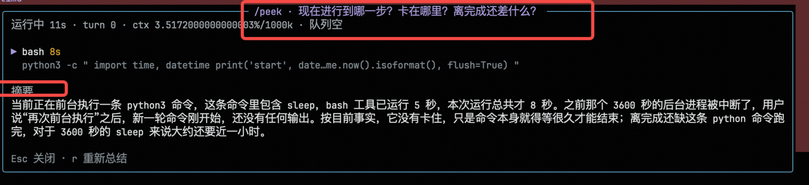

# pi-peek

一眼看到主 agent 现在到底在做什么 —— 只读面板，不写入会话上下文，不打断正在跑的任务。

```
/peek
```

面板浮在正在运行的会话上方：下面那半屏是主 agent 的实时输出，主输入框和正在跑的任务都不受影响。



## 为什么需要它

pi 在跑长任务时，用户看不到进度。两个具体后果：

1. **黑屏**：状态行只有一个转圈和 `Working (esc to interrupt)`，没有耗时、没有轮次、没有当前工具。
2. **消息排队**：这时输入 `Enter` 发出一条消息，它进入 steering 队列，要等**当前这一轮的全部工具跑完**才交给模型。如果一个 bash 跑 10 分钟，你的问题就等 10 分钟。

`/peek` 解决第 1 条：扩展命令在流式过程中**立即执行**，不排队，打开面板就能看到真实进度。

## 安装

```bash
# 从 git
pi install git:https://github.com/chenzier/pi-peek

# 临时试用，不安装
pi --extension /path/to/pi-peek/extensions/peek.ts
```

或者把 `extensions/peek.ts` 复制到 `~/.pi/agent/extensions/`（单文件即可运行）。

## 用法

```
/peek                       # 默认问：现在到哪一步、卡在哪、还差什么
/peek 为什么这个 bash 这么慢   # 自定义问题
```

| 键 | 作用 |
| --- | --- |
| `Esc` | 关闭面板；摘要生成中时先中止该请求 |
| `r` | 重新生成摘要 |

## 面板里有两种信息

**上半：确定性事实，不调用模型。** 每 0.5 秒刷新，秒表会走。

| 内容 | 来源 |
| --- | --- |
| 运行 / 空闲，已耗时 | `agent_start` / `agent_end` |
| 第几轮 | `turn_start.turnIndex` |
| 正在执行哪些工具、各自已耗时 | `tool_execution_start` |
| 最近完成的工具、耗时、是否失败 | `tool_execution_end.durationMs` |
| 新消息是否在队列里等待 | `ctx.hasPendingMessages()` |
| 上下文占用 | `ctx.getContextUsage()` |

**下半：一次独立的小请求。** 它拿到的是**这个会话的完整上下文**——当前分支的全部消息，工具调用连同参数（每个调用留 240 字符）都在，因为一句 `docker buildx build` 脱离任务背景就是噪声。每条消息上限 1200 字符（头 60% + 尾 40%），避免一条巨大的工具输出吃掉全部预算。

超过模型窗口预算时才会退化成「开头 2 条（原始任务或压缩摘要）+ 最近 60 条」，此时面板的摘要行会明确写 `节选 62/709 条（超出窗口）`，不会假装给了全量。

摘要行同时显示这次实际喂进去多少：`摘要 · 全量 128 条 / 41k 字符`。系统提示要求它不要粉饰：工具跑了很久没输出，就直说。

顺序是**历史在前、事实在后**：历史是稳定前缀，同一轮 run 里反复 `/peek` 能命中 prompt cache；事实块每次都变，放在最后。

事实在上、摘要在下，是有意的：确定性数据压住模型的措辞。

## 「不进入上下文」是构造保证

- 面板文字只写入终端，不写回主 transcript。
- 摘要是一次独立的 `ctx.modelRegistry.complete()` 调用，不追加用户消息，不触发新一轮 agent loop。
- 事件处理器只读：任何 handler 都不修改消息、工具或会话条目。

## 成本与限制

- **成本**：每次 `/peek` 把整个分支重发一遍。709 条消息的会话实测 354k 字符 ≈ 161k 输入 token；短任务通常十几k。开了 `cacheRetention: "short"`，同一轮里重复 `/peek` 命中缓存前缀，只有变化的尾部要重算。`r` 手动重跑，不会自动消耗。
- **窗口预算**：默认允许上下文占模型窗口的 55%（按 2.2 字符/token 估算）。1M 窗口 → 1.21M 字符，200k 窗口 → 242k 字符。超预算才退化成节选模式。
- 面板打开时**抓焦点**，主输入框暂时收不到按键。这是有意的：`Esc` 永远关面板，不会误 abort 主 agent。想边看面板边继续对话，把 `peek.ts` 里的 `overlayOptions` 加上 `nonCapturing: true`，届时关闭要靠 `/peek` 重新触发。
- 队列只显示是否存在（`hasPendingMessages()` 不暴露条数），所以写作 `队列 1+`。
- 长工具在飞时不会有新事实 —— 这正是它的用途：面板会显示 `bash 9m37s` 和"没有新的输出"，而不是假装在推进。

## 开发

```bash
pnpm install
pnpm typecheck      # tsc --strict
pnpm render-check   # 用合成状态打印面板，不需要 TUI（输出见 docs/panel.txt）
```

在 pi 1.1.0 上开发与验证；类型检查同时对 `@earendil-works/pi-coding-agent@1.4.0` 通过。

## License

MIT